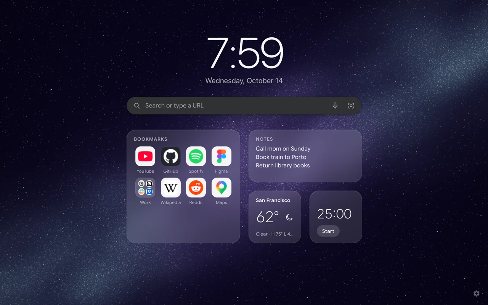
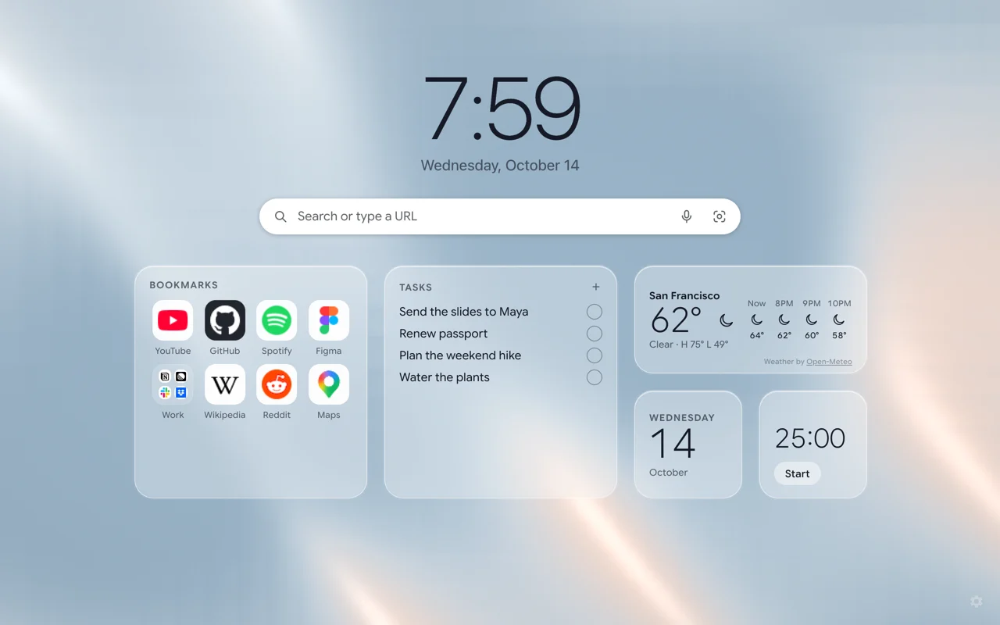
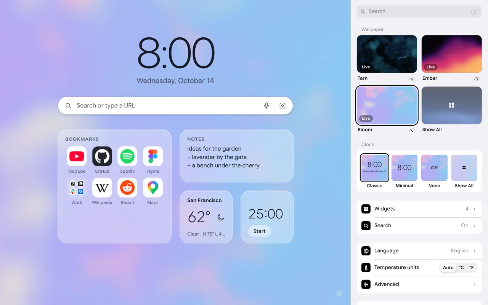
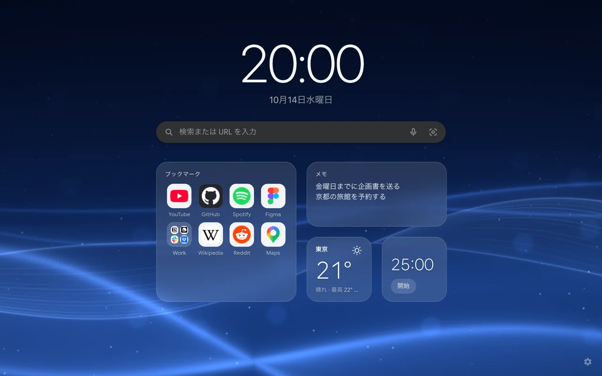
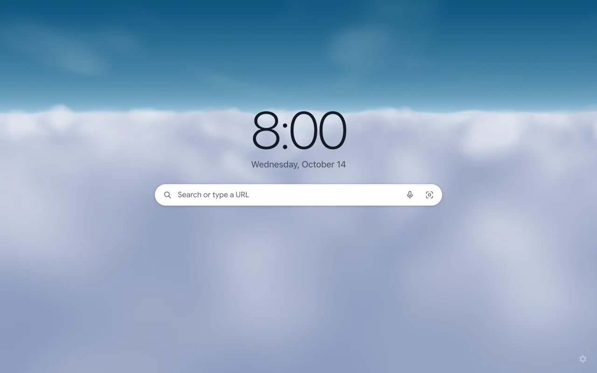

<p align="center">
  <picture>
    <source media="(prefers-color-scheme: dark)" srcset=".github/readme/header-white.png" />
    
  </picture>
</p>

<p align="center">
  
  
  
  
  
</p>

<p align="center">
  A new tab extension that renders a live WebGL2 scene and still costs
  about as much as Chrome's own static new tab.<br />
  Zero network requests at load. First paint in ~60 ms. Chrome, Edge,
  Brave, Arc, Opera, Vivaldi and Firefox.
</p>

---

## 「Stand Stats」

| Stand: **Tarn**       | Grade | Because                                                      |
| --------------------- | :---: | ------------------------------------------------------------ |
| Power                 | **A** | 16 hand-written shaders, 15 clock faces, 7 widget kinds      |
| Speed                 | **A** | First paint in about 60 ms, on par with the fastest new tabs |
| Range                 | **A** | Every Chromium browser and Firefox, from one codebase        |
| Durability            | **A** | Automatic backup before every update; never loses a setup    |
| Precision             | **A** | Frost drawn per pixel, frames paced to the millisecond       |
| Development potential | **B** | 1.0.1                                                        |

## Performance

The whole point of Tarn is a scene that moves without your laptop noticing.
Measured on an Apple M4 in Chrome:

|                                | Tarn       | Chrome's new tab | Other extensions  |
| ------------------------------ | ---------- | ---------------- | ----------------- |
| Network requests at load       | **0**      | 4                | 0–115             |
| Page CPU, live scene at 30 fps | **5.9%**   | 5.8% (static)    | 0.3–0.8% (static) |
| JS memory                      | **6.2 MB** | 7.9 MB           | 2.0–57.9 MB       |
| Frames in a hidden tab         | **0**      | 0                | varies            |

How it gets there:

- **Off the main thread.** The scene renders in a Web Worker through an
  `OffscreenCanvas`. The page's own thread stays well under 1% while
  idle: no layouts, no style recalculations; the clock wakes once a minute.
- **Paced, not spinning.** 30 fps while you use the page, easing to 20 fps
  at 40% speed after a minute without input. Between frames the loop
  sleeps on a timer instead of waking for every 120 Hz refresh.
- **Hidden tab? ZA WARUDO.** Time stops: zero frames, nothing drawn,
  until you come back.
- **Measured GPU cost per scene.** Each wallpaper's shader is benchmarked
  in ms per frame (0.007 ms for the lightest, 0.19 ms for the sharpest)
  and shown as a gauge in settings, so a slow GPU gets an honest warning.
- **Adaptive quality.** A governor watches frame timing and steps
  resolution and frame rate down (1× at 30 fps → 0.5× at 20 fps) when
  frames run late, then back up after 20 s of headroom. Soft scenes
  render at 0.2–0.5× and upscale invisibly; detailed ones at screen
  density.
- **Frosted glass without `backdrop-filter`.** The blur behind widgets is
  drawn in the same shader pass from mipmaps of the frame, instead of the
  compositor re-blurring a moving canvas every frame (~8% → ~2%
  compositor CPU).
- **No flash on reload.** A 320 px frame of the scene is kept per tab and
  painted synchronously in the first frame, then the live scene continues
  from the exact same moment.
- **Reduced motion** holds a still frame. No WebGL, or a computer that
  can't keep up? A still picture of the scene takes over (within 2.5 s
  when nothing draws).

## Features

- **16 live wallpapers** (WebGL2, no libraries), or your own photos.
- **15 clock faces**, from Classic to Flip, LCD, Neon, Analog and Fraktur.
- **Widgets** on a fixed grid: bookmarks, notes, tasks, calendar, timer,
  weather, and custom widgets written as fragment shaders.
- **Search box** using your browser's own engine, with bookmark
  suggestions, voice, Google Lens and AI Mode.
- **Settings in the side panel**, searchable, light or dark, with
  keyboard shortcuts, sync through your browser account, automatic
  backups, export and import.
- **10 languages**, following your browser.
- **Private:** no server, no account, no analytics. Tarn goes online only
  for what you ask: a search when you press Enter (to your browser's own
  engine), voice, Lens or AI Mode when you use them, and Weather for the
  place you pick. [PRIVACY.md](PRIVACY.md)

## Build

```bash
npm install
npm run build            # Chromium → dist/chrome-mv3
npm run build:firefox    # Firefox  → dist/firefox-mv3
npm run dev              # live-reloading build in dist/chrome-mv3-dev
npm run check            # typecheck, lint, test, build
```

Load `dist/chrome-mv3` from `chrome://extensions` (Developer mode → Load
unpacked), or any file in `dist/firefox-mv3` from
`about:debugging#/runtime/this-firefox`.

**Stack:** TypeScript (strict), [Lit](https://lit.dev) as the only runtime
dependency, raw WebGL2, plain CSS, [WXT](https://wxt.dev), Manifest V3.

## Screenshots

<table>
  <tr>
    <td width="50%"></td>
    <td width="50%"></td>
  </tr>
  <tr>
    <td width="50%"></td>
    <td width="50%"></td>
  </tr>
  <tr>
    <td colspan="2"></td>
  </tr>
</table>

## License

[PolyForm Shield 1.0.0](LICENSE): use it, read it, fork it and learn from
it; just don't ship a competing product from it.

Fonts under the SIL Open Font License; weather by
[Open-Meteo](https://open-meteo.com) (CC BY 4.0).

<p align="center"><sub>Yare yare daze.</sub></p>
