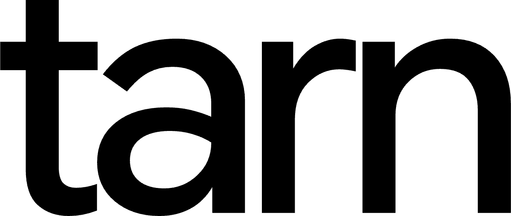
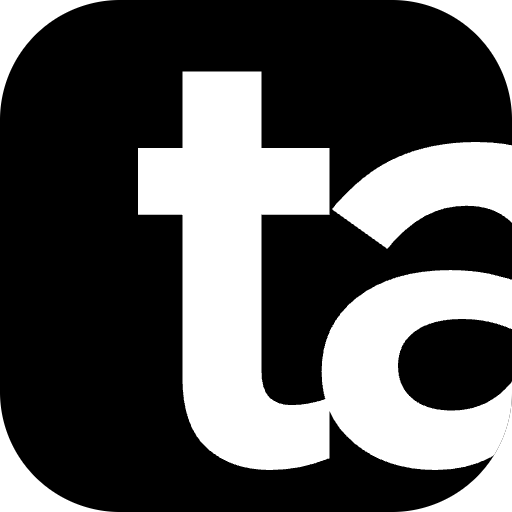

# Tarn brand

The single source of truth for how Tarn looks, sounds and is named. Read it
before any visual, naming, icon, store-listing or marketing work. Decisions
here were made with the owner on 2026-10-11; the
[decision log](#decision-log) lists what was tried and rejected, so nobody
re-proposes it.

## The short version

- **The brand is the word.** Lowercase `tarn`, set in default Google Sans
  Flex. There is no logo.
- **Black and white.** Pure `#000000` and `#FFFFFF` for every brand mark.
  No near-black, no blue-grey, no brand hue.
- **The mark exists only for square slots** (toolbar button, extensions page,
  store icon, avatars): `ta`, with the `a` cut in half by the frame.
- **Light first.** Tarn follows the system theme. Light is the face; dark is
  the automatic twin.
- **The living background is the signature.** The slow WebGL water and cloud
  scene is what people remember, not a logo or a color.
- **Never "Chrome" in the name.** "Works with Google Chrome™" goes in
  descriptions only.

## Name

| Use                                 | Write it as                                                    |
| ----------------------------------- | -------------------------------------------------------------- |
| In sentences, titles, store listing | **Tarn**                                                       |
| The wordmark (artwork only)         | **tarn** (lowercase, from the SVG file)                        |
| Never                               | TARN, TaRN, Tarn™ in running text, "Tarn for Chrome" as a name |

- Manifest `short_name` is **Settings** ("Dev Settings" in dev): Chrome
  uses it only to title Tarn's side panel and its pin button. The `name`
  stays **Tarn**.
- _tarn_ (n.): a small, still mountain lake. From Old Norse _tjörn_.
- Store title: **Tarn: Calm New Tab**.
- Compatibility line, descriptions only: "Works with Google Chrome™,
  Microsoft Edge, Brave, Arc, Opera, Vivaldi and Firefox."
- Google's Chrome Web Store
  [branding guidelines](https://developer.chrome.com/docs/webstore/branding)
  forbid Google trademarks in an extension's name or logo without written
  permission. Breaking this gets a listing rejected or taken down.

## Wordmark

The primary and usually only brand element.



| Spec     | Value                                                                        |
| -------- | ---------------------------------------------------------------------------- |
| Text     | `tarn`, lowercase                                                            |
| Font     | Google Sans Flex, default design: `wdth 100`, `ROND 0`, `slnt 0`, `opsz 144` |
| Weight   | 500                                                                          |
| Tracking | −0.03em between letters                                                      |
| r–n gap  | +0.012em extra before the `n` (see below)                                    |
| Files    | `assets/tarn-wordmark.svg` (black), `-white.svg`, `-mono.svg` (currentColor) |

- **The r–n rule.** Squeezed together, `rn` reads as `m` and "tarn" becomes
  "tam". The extra gap before the `n` prevents that. Never tighten it, and
  never retype the wordmark as live text in a logo context; use the SVG.
- **Clear space:** at least the height of the `a` on every side.
- **Minimum size:** 48px wide on screen, 12mm in print.
- **Color:** pure black on light backgrounds, pure white on dark ones, or one
  color via the mono file (inline it in HTML so `currentColor` works; inside an
  `` it renders black).
- **Don't:** recolor it with gradients or rainbows, add shadows, outline it,
  stretch it, set it in caps, or put a symbol in front of it as decoration.

## Mark (only when a square is unavoidable)

Tarn has **no logo**. The mark is a fallback for places that physically need
a square image and can't show the word. If the word fits, use the word.



### What it is

The letters `ta` set large in a rounded square, positioned so the right edge
of the square **cuts the `a` through its middle**. It reads as the start of
the name running off the edge, the way a still horizon runs past the frame.
It's abstract, but it's still the word.

### Construction

All values are in the square's own units (128 × 128, y grows downward). They
live as constants in [`build_logo.py`](build_logo.py).

| Spec      | Value                                                                                                                    |
| --------- | ------------------------------------------------------------------------------------------------------------------------ |
| Square    | 128 × 128, corner radius 30                                                                                              |
| Text      | `ta`                                                                                                                     |
| Font      | Google Sans Flex, `wght 600`, `wdth 100`, `ROND 0`, `slnt 0`, `opsz 144`                                                 |
| Size      | 150 units                                                                                                                |
| Pen start | x = 34                                                                                                                   |
| Baseline  | y = 116 (the bottom of `t` and `a` sit 12 units above the edge)                                                          |
| Tracking  | −0.04em                                                                                                                  |
| Cut       | The square clips the `a` at about its middle. The `t` is never clipped.                                                  |
| Small     | For 16–32px, the same mark from `opsz 18` (`tarn-mark-small.svg`): its wider counters keep the `a` open at toolbar size. |

### When to use it

| Slot                                          | Use the mark?                                                                                                                         | File                                                                                                       |
| --------------------------------------------- | ------------------------------------------------------------------------------------------------------------------------------------- | ---------------------------------------------------------------------------------------------------------- |
| Chrome toolbar button (`action.default_icon`) | Yes                                                                                                                                   | `png/extension/action-16.png`, `action-32.png` (small master), shipped as `public/action/16.png`, `32.png` |
| `chrome://extensions` page and store listing  | Yes                                                                                                                                   | `png/extension/icon-48.png`, `-96.png`, `-128.png`, shipped as `public/icon/48.png`, `96.png`, `128.png`   |
| Dev build ("Tarn Dev")                        | The white mark, so dev and prod tell apart                                                                                            | `png/extension-dev/*` (swapped in by `wxt.config.ts` in development)                                       |
| Chrome Web Store icon upload                  | Yes                                                                                                                                   | `png/store/tarn-store-icon-128.png` (96px art + 16px transparent padding, as Google requires)              |
| Social avatar                                 | Yes                                                                                                                                   | `png/social/tarn-avatar-800.png` (square corners; platforms crop it)                                       |
| App-style icon, website favicon, large uses   | Yes                                                                                                                                   | `tarn-mark.svg`, `png/mark/tarn-mark-64…1024.png`                                                          |
| The browser tab's icon                        | **No.** The tab shows Chrome's own icon on purpose; `public/icon/16.png` and `32.png` stay transparent (see `AGENTS.md`, Permissions) | —                                                                                                          |
| On the new tab page itself                    | **No.** The page belongs to the user; no branding on it                                                                               | —                                                                                                          |
| Next to the wordmark                          | Only in store art and the README header                                                                                               | —                                                                                                          |

### Colorways

| File                  | Square                     | Letters     | Use                                              |
| --------------------- | -------------------------- | ----------- | ------------------------------------------------ |
| `tarn-mark.svg`       | Black `#000000`            | White       | The default, everywhere                          |
| `tarn-mark-white.svg` | White + 14% black hairline | Black       | Dark backgrounds where a white tile reads better |
| `tarn-mark-mono.svg`  | `currentColor`             | Knocked out | One-color uses; inline it                        |
| `*-small.svg`         | Same three                 |             | The 16–32px master                               |

### Don't

- Un-cut the `a`, center the letters, or show the whole `a`.
- Cut the `t`, crop the top or bottom, or crop tighter (it stops reading as
  letters; tried and rejected).
- Use `tarn` or `rn` in the square (reads as "tam"; rejected).
- Change the font, weight, roundness or width.
- Add gradients, rainbow, glow, shadows, outlines or 3D.
- Use it below 16px, or redraw it by hand. Regenerate it with the script.

## Type

- **Brand typeface: Google Sans Flex, default design.** No roundness, no
  width change, no custom tuning. The owner rejected the rounded version
  explicitly.
- **Weights:** 500 for the wordmark and headings, 600 for the mark, 400 for
  text.
- **License:** SIL Open Font License 1.1, released by Google on Google Fonts
  in 2025. Its license file declares no Reserved Font Name. Commercial use,
  logos and bundling inside the extension are allowed.
  - Bundled in `public/fonts/`: a Latin subset of the variable font with
    weight and optical size (about 140 KB), roundness, width and slant pinned
    to the default, with `OFL.txt` next to it. Never load it from Google at
    runtime (Tarn makes no network requests).
  - Don't market Tarn as "made with Google's font" or imply that Google
    endorses it.
  - Only use **Google Sans Flex** from Google Fonts. The original "Google
    Sans" files are proprietary.
- **Product UI:** Google Sans Flex everywhere, through `--font-sans` in
  `src/styles/global.css`, with the system font as fallback.
- **Case:** sentence case for UI text. Never all caps for the name.

## Color

**The brand is black and white.** Pure `#000000` and pure `#FFFFFF` for the
wordmark, the mark and brand surfaces (store art, README, social). No
near-black, no blue-grey, no tints, and no brand hue.

| Brand | Hex       | Role                                            |
| ----- | --------- | ----------------------------------------------- |
| Black | `#000000` | The wordmark and mark on light; the dark ground |
| White | `#FFFFFF` | The wordmark and mark on dark; the light ground |

The color lives in the **living background**, and only there. These scene
colors never appear in a mark, a logo lockup or UI chrome:

| Scene     | Hex       | Role                             |
| --------- | --------- | -------------------------------- |
| Snowfield | `#EEF2F5` | Light scene base                 |
| Ice       | `#CFE3EC` | Light scene body                 |
| Peat      | `#05080F` | Dark scene base, first paint     |
| Deepwater | `#0D2740` | Dark scene body                  |
| Glacier   | `#1F6178` | Scene light                      |
| Meltwater | `#A9CFE0` | Highlights                       |
| Alpenglow | `#F2B8A0` | A rare warm accent inside scenes |

UI controls stay colorless frosted glass (`--glass-*` in
`src/styles/global.css`). Never use Google's four brand colors (blue, red,
yellow, green) together, or anything that reads as a modified Google mark.

## Backgrounds: the signature

The living WebGL scene is Tarn's identity: slow, domain-warped noise that
moves like water or cloud. The owner loves it, and it's what store art should
show.

- **Light first:** a light water/cloud scene when the system is light, and
  the dark scene as its twin. Follow `prefers-color-scheme`, and never flash
  the wrong one (see "Arrival" in `AGENTS.md`).
- **Calm motion:** slow, continuous, no sudden changes. A single ripple when a
  tab opens is fine.
- **Hand-written WebGL2 only,** following `AGENTS.md` (performance, reduced
  motion, pausing when hidden).
- **Rejected for good:** prism and rainbow scenes, iridescent "pearl"
  effects, rainbow glow around UI. The owner rejected two prism attempts on
  2026-10-11. Don't propose spectral or rainbow effects again.

## Voice

Use fewer words than anyone. Tarn never asks for something the user didn't
ask for.

| Situation     | Not this                                      | This                                                                               |
| ------------- | --------------------------------------------- | ---------------------------------------------------------------------------------- |
| Opening a tab | "Good morning! What's your main focus today?" | (nothing)                                                                          |
| Turning off   | "Are you sure? You'll lose your setup."       | "Tarn is off. New tabs open your browser's page."                                  |
| A setting     | "Background renderer (WebGL2)"                | "Background"                                                                       |
| Upsell        | "Unlock 1,000+ HD photos with PRO!"           | "More scenes come with Tarn+. Your free scenes stay free."                         |
| GPU failure   | "Something went wrong."                       | "This scene needs graphics your browser can't use. Showing a still frame instead." |

## Store and marketing

| Asset                           | Size               | Content                                                                                        |
| ------------------------------- | ------------------ | ---------------------------------------------------------------------------------------------- |
| Icon                            | 128 × 128          | `png/tarn-store-icon-128.png`                                                                  |
| Small promo tile (required)     | 440 × 280          | A still of the light scene with the black or white wordmark. Google advises little to no text. |
| Marquee (needed to be featured) | 1400 × 560         | Same, wider                                                                                    |
| Screenshots                     | 1280 × 800, 1 to 5 | Real new tabs: light, dark, settings                                                           |
| Video                           | YouTube link       | 20 seconds of the scene moving, plus one ripple                                                |

- Lockup (store, README): mark + wordmark side by side, wordmark ink height
  about 70% of the mark, gap about 25% of the mark.
- Next to Chrome: `tarn | for Google Chrome™`, with the second part in grey
  `#5F6368`, smaller, in Google Sans Flex 400.

## Legal

- **Code:** Apache 2.0. Apache 2.0 grants **no trademark rights** (section
  6), so the Tarn name, wordmark and mark aren't licensed for others' use by
  the code license.
- **Font:** the outlined SVGs are artwork made with an OFL font; the OFL
  doesn't apply to artwork. Shipping the font file itself requires shipping
  `OFL.txt`.
- **Google:** no Google trademarks in Tarn's name, mark or icon, and no
  implied endorsement.

## Files

```
docs/brand/
  BRAND.md                    this document
  build_logo.py               regenerates every SVG from the constants above
  assets/
    tarn-wordmark.svg         black
    tarn-wordmark-white.svg
    tarn-wordmark-mono.svg    currentColor; inline it
    tarn-mark.svg             black square, white letters (default)
    tarn-mark-white.svg       white square, black letters, hairline edge
    tarn-mark-mono.svg        currentColor square, letters knocked out
    tarn-mark*-small.svg      the 16–32px master (opsz 18)
    png/
      extension/              action-16, action-32, icon-48, icon-96, icon-128
      store/                  tarn-store-icon-128 (with the required padding)
      mark/                   tarn-mark 64–1024, tarn-mark-white 512, 1024
      wordmark/               black and white, 1200 wide, transparent
      social/                 avatars 800 (black, white), link previews 1200×630
```

To regenerate (only if the brand changes, with the owner's approval):

```bash
python3 -m venv .venv && .venv/bin/pip install fonttools uharfbuzz
.venv/bin/python docs/brand/build_logo.py --font path/to/GoogleSansFlex[ROND,opsz,slnt,wdth,wght].ttf
```

The script shapes text with HarfBuzz, so kerning matches what browsers draw,
then outlines it with fontTools. Re-export the PNGs from the SVGs afterward at
the sizes listed above (any SVG renderer; headless Chrome with a transparent
background works), and copy the extension set into `public/action/` and
`public/icon/`.

## Notes for AI agents

1. **Don't invent a logo.** No symbols, icons, monograms, mascots or new
   marks. The word is the brand; `ta` is the only mark.
2. **Don't edit SVG path data by hand.** Change the constants in
   `build_logo.py` and regenerate, and only with the owner's approval.
3. **Default Google Sans Flex only.** Never round, widen, slant or "tune" it.
   **Pure black and white** for brand marks; scene colors stay in scenes.
4. **No rainbow, prism, iridescence or AI-style glow.** Anywhere.
5. **Light first, follow the system.** Every new visual needs a light version
   and a dark twin.
6. **Never put the mark or wordmark on the new tab page.** The page is the
   user's.
7. **"Chrome" never goes in a name or mark.** Check every store string
   against the Name section.
8. **Show, don't tell.** The owner prefers visual comparisons rendered at real
   sizes over long text. Render options (for example with headless Chrome)
   and look at them before recommending one.
9. If a task seems to need something this document forbids, ask the owner
   instead of working around it.

## Decision log

Everything below was shown to the owner on 2026-10-10 and 2026-10-11.

| Option                                        | Outcome                 | Why                                                             |
| --------------------------------------------- | ----------------------- | --------------------------------------------------------------- |
| Albert Sans wordmark                          | Replaced                | The owner preferred Google Sans Flex once it proved legal       |
| Google Sans Flex, roundness 60 ("soft")       | **Rejected**            | The owner: default only, not soft                               |
| "Still" symbol (half sun over its reflection) | Retired                 | The owner chose text over a pictorial symbol                    |
| Glowing horizon line icon (the original)      | Retired                 | Read as a minus sign                                            |
| Wordmark with an underline                    | Rejected                | Reads as a link; as an icon it shrinks to a minus sign          |
| Plain `t` in a square                         | Not adopted             | Clear, but generic                                              |
| `ta / rn` stacked (American Express style)    | Not adopted             | Great at 128px, mush at 16px; `rn` reads `m`                    |
| `ta / rn` outlined                            | Rejected                | Thin strokes vanish below 48px                                  |
| `tarn` bleeding off the square                | Rejected                | Reads "tam"                                                     |
| `t` or `ta` at a waterline with a reflection  | Rejected                | The `t` reads as a cross                                        |
| Glacier-blue mark, blue-grey (Granite) ink    | Replaced 2026-10-12     | The owner: black and white, not grey-ish                        |
| Small optical size (opsz 18) for 16–32px      | Adopted 2026-10-12      | Keeps the `a` open in the toolbar                               |
| **`ta`, `a` cut in half**                     | **Adopted**             | The owner: "super sick". Bold at 16px, abstract, still the name |
| Pearl iridescent scene                        | **Rejected**            | Washed out                                                      |
| Dispersed-light prism scene (light and dark)  | **Rejected**            | The owner: forget prism entirely                                |
| Full rainbow, rainbow UI glow                 | Rejected                | Loud, reads as an AI feature                                    |
| All caps TARN                                 | Rejected                | Loud; Google never caps product names                           |
| Dark-first brand                              | Replaced by light first | Matches the browser around the tab                              |
