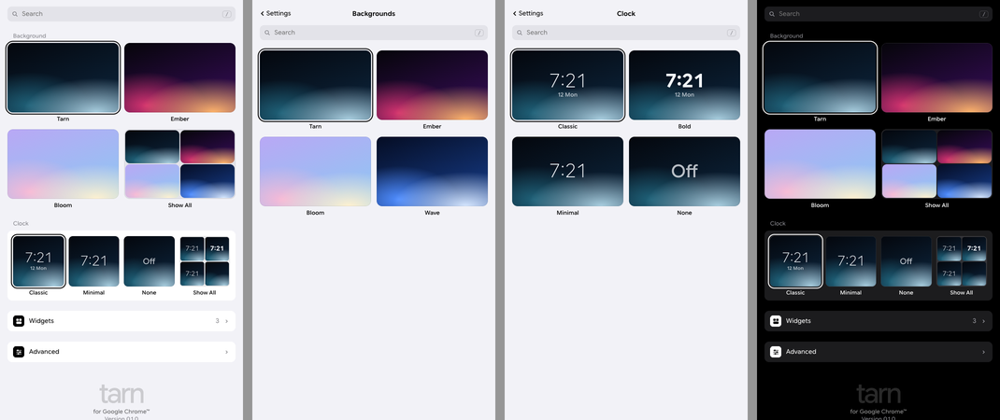

# The settings panel

How Tarn's settings are organized, and the rules for adding to them. The
panel lives in the browser's side panel next to the new tab
(`src/panel/tarn-panel.ts`); every change applies to open tabs at once.

Decided with the owner on 2026-10-12, after comparing tabs against a list in
a live prototype: [Tarn Settings Panel](https://claude.ai/artifact/6mQoz7iAkLC3wiomqzW1Yn).



## The shape: a list that goes deeper

One scrolling list, like the system settings on a phone. The first screen
shows the few things most people change; each section ends in a row that
opens a page with the rest. There are no tabs and no close button (the
browser's side panel has its own).

```
Settings (home)
├── Search                         finds every setting, on any page
├── Wallpaper                      4 big tiles: 3 scenes + "Show All"
│   └── Wallpapers                 Add Photo…, Your Photos, then the live
│                                  scenes; search filters both
├── Clock                          a card: Classic, Minimal, None + "Show All"
│   └── Clock                      all 8 faces; search filters them
├── Widgets ›                      on your tab (size, remove) + add
├── Advanced ›                     always last
└── Signature                      wordmark, "for Google Chrome™", version,
                                   Privacy · Source code

Advanced
    ├── Tab icon                   (Chromium only)
    ├── Keyboard                   the shortcuts that exist
    ├── Backup                     export, import, reset
    ├── settings.json              view and edit the raw settings
    └── About                      version, copy diagnostics
```

## Rules

1. **Home holds what most people change.** Today that's the wallpaper,
   the clock and widgets. Anything else goes one level down.
2. **Show a few, then "Show All".** A picker shows three choices and a
   fourth tile, "Show All" (a background, blurred and faded, with a grid icon), that opens a page
   with all of them (`HOME_SCENES`, `HOME_FACES` in the panel). Backgrounds
   are big 16:10 tiles on the page, the main tool; the clock is a card of
   square tiles under them. Sub-pages are just the grid: no preview, the
   tab next to the panel already shows the result. The current choice is
   always among the tiles. The first screen never grows just because the
   catalog does.
3. **Pictures, not names.** Scenes and clock faces are picked from
   thumbnails drawn on the user's real background.
4. **Advanced is last and is called Advanced.** Not "Developer": it holds
   the tab icon, keyboard, backup and the raw settings file, which normal
   people need sometimes too.
5. **Search finds everything.** Every setting has an entry in
   `SEARCH_INDEX` with the page it lives on. Picking a result opens that
   page and highlights the row. `/` focuses search; Escape clears it.
6. **Changes are live.** No Save button. Removing a widget or resetting
   shows a toast with Undo.
7. **The panel doesn't turn Tarn off.** The owner removed the "Use Tarn
   for new tabs" switch on 2026-10-13 as not needed; the browser's
   extensions page does that. Import, reset and `settings.json` never
   change `enabled` either.
8. **No fake features.** Nothing in the panel says "Soon". Add a row when
   the feature ships.

## Look

- **Light first, with a dark twin**, following `prefers-color-scheme`. A
  grouped list: grey page, white rounded groups, hairlines between rows
  inset past the icon.
- **Black and white.** Icon tiles are black with white glyphs (white with
  black in dark). Switches are black when on (white in dark). No brand hue,
  per `docs/brand/BRAND.md`.
- **Filled icons**, drawn for Tarn in `src/ui/glyphs.ts`: one solid shape
  with details cut out, readable at 15px in a 24px tile. Never outline
  icons, never emoji.
- **Chrome's header says "Settings"; the panel shows the wordmark.**
  Chrome draws the side panel header itself, from the extension's icon and
  its manifest `short_name` (no API changes it, and `document.title` is
  ignored; see `SidePanelUtil::GetTitleText` in Chromium). So `short_name`
  is "Settings" ("Dev Settings" in dev, both within the 12-character
  limit), and the extension's `name` stays "Tarn" everywhere else (store,
  install dialog, extensions page). The home page opens on search and ends on the
  signature (`src/ui/wordmark.ts`); sub-pages open with the bar described
  below.
- **Desktop proportions, like macOS System Settings:** 13.5px titles, 12px
  descriptions, 24px icon tiles with 15px glyphs, 10px group corners, a 32px
  search field. Switches are 34×20, like Safari's settings, not phone-sized.
  The sizes are tokens at the top of the panel's styles (`--title`,
  `--icon`, `--row-x`...); change them there, not per row.
- **One line per row; explanations go under the box.** Like iOS and macOS
  settings, a row is an icon, a title and a control or value (Widgets ›
  shows "3"). What a setting does is a short note below its group, not a
  second line in the row. Only "Add a widget" keeps a description line,
  because there it is the point.
- **Widgets are moved on the tab, not in the panel.** While the panel is
  open the tab is in edit mode, and dragging there is direct; the panel
  only sizes and removes them.
- **The signature closes home, centered:** the wordmark faded, "for" and
  the browser's own name (only names a browser reports: "Google Chrome™"
  per BRAND.md, Edge, Opera, Brave, Vivaldi, Firefox; nothing otherwise),
  the version, then Privacy (`PRIVACY.md`) and Source code links. A plain
  line, never Google's logo or colors.
- **One icon rule for every row.** The icon's box is exactly as tall as a
  title plus one description line, so it sits centered beside one or two
  lines and stays top-left once a description wraps further (or a row holds
  a control under its title, like widget sizes). No per-row exceptions, no
  measuring in script. Controls on the right stay vertically centered.
  Hairlines start where the text does.
- Sub-pages open with an iOS-style bar: "‹ Settings" on the left, the
  page's name centered, search under it.
- **Corners are concentric.** A selected tile's ring sits 4px outside it,
  so a tile inside a 10px card has a 6px radius and its ring traces the
  card's corner. Change the card radius and the tile radius together.
- Clock tiles are square (16:10 on the Clock page), and their clock
  text is sized in container units, so a thumbnail is a true small copy at
  any panel width.
- Text is Google Sans Flex (bundled, see
  `src/styles/global.css`).

## Adding a setting

1. Add it to `Settings` in `src/settings/schema.ts`, with a default and a
   normalizer branch (stored data is never trusted).
2. Pick its place with rule 1: home only if most people will change it.
   Otherwise it goes on an existing page, or in Advanced.
3. Give the row a filled glyph (add one to `glyphs.ts` if needed) and a
   `data-target` id.
4. Add a `SEARCH_INDEX` entry pointing at that page and id.
5. If it can be exported, make sure `replaceSettings` carries it.

## When to switch to tabs

If Tarn grows past about six sections, the home sections can become tabs at
the top. The pages underneath stay exactly the same, so nothing is rebuilt.
Until then the list wins: people don't have to guess which tab holds a
setting, and Advanced stays out of sight.

## Rejected

- **Tabs now:** people have to guess the tab, and four labels barely fit in
  a 330px panel.
- **"Developer" section:** the name scares off normal users. It's
  "Advanced".
- **A close button:** the side panel already has one.
- **"Tarn" in Chrome's header with the wordmark below it:** the name read
  twice. Chrome's header now says "Settings" instead.
- **The ta mark in the panel:** Chrome's header already shows it next to
  "Settings". The panel keeps just the wordmark.
- **The wordmark at the top:** it pushed search down and competed with
  Chrome's "Settings" header. It closes the page instead.
- **"Tarn Settings" as the short name:** 13 characters, over Chrome's
  limit of 12.
- **A clock on/off switch:** the clock is picked by face, and "None" is one
  of the faces.

## Your own photos

"Add Photo…" sits right under the search on Wallpapers. Picked images
(several at once is fine) are stored by `src/wallpapers/store.ts` in
IndexedDB on this computer only: the original untouched, a display copy
(WebP, at most 3840px) and a 480px thumbnail, plus the photo's mean color
and tone. A small index of colors and sizes is mirrored to localStorage
(`tarn.photos`) so first paint knows a photo's color without waiting.

- A photo is chosen through the same `scene` setting, as `photo:<uuid>`.
  Settings sync, photos don't: another computer without the photo shows
  the default scene.
- Adding selects the new photo. The badge on a photo's corner (on hover
  or keyboard focus) deletes it, with Undo; deleting the current photo
  goes back to the default scene.
- The background draws photos still, through the renderer, so they
  arrive, crossfade and ghost on reload like any scene.
