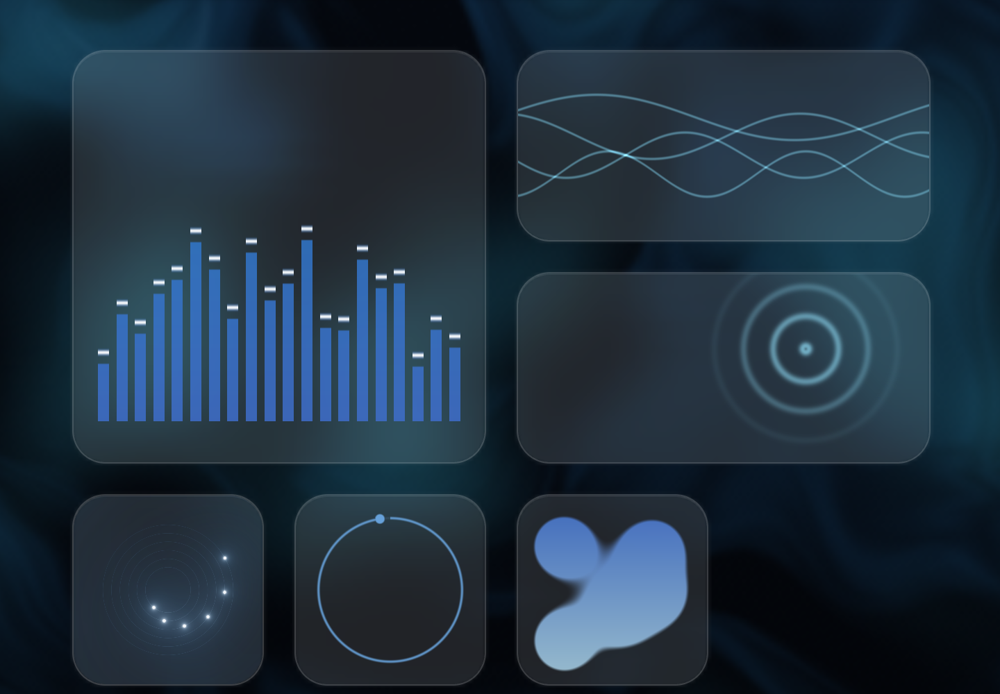

# Widgets

How Tarn's widgets work, how they are laid out, what each one does, and how
to add one. This is the single reference for widget work. It replaced
`docs/widgets.md` and the widget parts of `AGENTS.md` (2026-10-14).

Try the layout: [Tarn Grid Prototype](https://claude.ai/artifact/VDhBDwfCENLt38LDbbND5Z).
Open it full screen and resize the window.

## 1. Summary

- A widget is one custom element plus one entry in `src/widgets/registry.ts`.
  Nothing else in Tarn needs to know about a kind, except a few typed maps
  (schema, panel, i18n) that the compiler points you to.
- There are seven kinds. The ids in code and storage never change; some
  user-facing names do:

  | Kind id     | Shown as  | Sizes       | Default size | Element          |
  | ----------- | --------- | ----------- | ------------ | ---------------- |
  | `favorites` | Bookmarks | S, M, L, XL | L            | `tarn-favorites` |
  | `notes`     | Notes     | M, L, XL    | M            | `tarn-notes`     |
  | `tasks`     | Tasks     | M, L, XL    | M            | `tarn-tasks`     |
  | `focus`     | Timer     | S, M        | S            | `tarn-focus`     |
  | `weather`   | Weather   | S, M, L     | M            | `tarn-weather`   |
  | `calendar`  | Calendar  | S, M, L     | L            | `tarn-calendar`  |
  | `code`      | Custom    | S, M, L, XL | M            | `tarn-code`      |

- Tiles are a fixed 136px cell with a 24px gap on every screen. Sizes are
  whole cells: S 1x1, M 2x1, L 2x2, XL 4x2.
- `src/layout/bands.ts` places widgets in bands two cells tall on a 2, 4 or
  6 column grid, with no holes. `src/widgets/tarn-board.ts` draws them with
  transforms and animates moves with FLIP.
- The settings side panel being open puts the tab in edit mode: drag,
  arrow keys, corner resize, rename, remove, and drop new widgets from the
  panel.
- Content lives in `storage.local` under `widget.<id>`, apart from the
  synced settings, with a localStorage mirror so a reload draws it in its
  first frame. Removing a widget keeps its content.
- Only Weather uses the network, and only after the user picks a place.
  Bookmarks reads the browser's bookmarks bar (required `bookmarks`
  permission); nothing leaves the computer.

### Read this before...

| Before you...                         | Read                                                                                   |
| ------------------------------------- | -------------------------------------------------------------------------------------- |
| change layout, sizes or the grid      | sections 3 and 6; `src/layout/bands.ts`; `src/layout/bands.test.ts`                    |
| change what a widget stores           | section 2 (storage), section 7 (cross-version), `AGENTS.md` "Never lose a setup"       |
| add a widget kind                     | sections 2 and 7; `docs/research/2026-10-new-tab-research.md` (what people want, skip) |
| add anything that touches the network | `AGENTS.md` "Network"; the Weather section here                                        |
| touch first paint or reload           | `architecture.md` "Arrival in detail"; section 2 (mirrors)                             |
| change edit mode or the panel         | sections 3 and 5; `docs/settings.md`                                                   |

## 2. Architecture

### A widget = custom element + registry entry

`src/widgets/registry.ts` holds `WIDGETS: Record<WidgetKind, WidgetDefinition>`:

```ts
interface WidgetDefinition {
  nameKey: MessageKey; // its name, also its default heading ('widget.<kind>')
  tag: string; // the custom element
  editable?: boolean; // has its own controls while arranging
}
```

The registry imports every widget module eagerly. That is on purpose: a
reload must draw every widget in its first frame (see Arrival in
`AGENTS.md`), and each widget is only a few KB. Do not lazy-load widgets.

`renderWidget(kind, id, editing, name)` renders the element with three
properties:

| Property   | Meaning                                                                             |
| ---------- | ----------------------------------------------------------------------------------- |
| `widgetId` | The entry's id; the key for its content (`widget.<id>`).                            |
| `editing`  | True while widgets are being arranged (the side panel is open in this window).      |
| `heading`  | The user's name for the widget (`WidgetEntry.name`), or the kind's translated name. |

Every widget should show `heading` as its title (`<h3>` with `widgetStyles`),
so a rename shows up. Calendar shows `"<name> · <month>"` when renamed, and
just the month otherwise. Focus does not use `heading` yet (see Known gaps).

A widget fills its tile. The tile (`.tile` in `tarn-board.ts`) is a size
container (`container-type: size`), so widgets adapt with `@container`
queries rather than reading their size. The breakpoints used across widgets:

| Query               | Tile it matches                          |
| ------------------- | ---------------------------------------- |
| `max-width: 200px`  | one cell wide (S, or S stretched to 1x2) |
| `min-width: 250px`  | two or more cells wide (M, L, XL)        |
| `max-height: 140px` | one cell tall (S, M)                     |
| `min-height: 250px` | two cells tall (L, XL, stretched S/M)    |

Shared styles are in `src/widgets/styles.ts`: `widgetStyles` (padding,
heading, ink colors, focus ring) and `sheetStyles` (a modal `<dialog>` for a
widget's own forms: adding a site, choosing a place).

### Widget entries (synced settings)

`WidgetEntry` in `src/settings/schema.ts`:

```ts
interface WidgetEntry {
  id: string; // /^[a-z0-9-]{1,40}$/, e.g. "notes-k3j9x2" (newWidgetId)
  kind: WidgetKind;
  size: WidgetSize; // 's' | 'm' | 'l' | 'xl'
  name?: string; // the user's name, trimmed, max 40; unset = kind's name
}
```

`Settings.widgets` is the ordered list, synced through `storage.sync`.
`normalizeWidgets` (schema.ts) drops broken entries and duplicate ids,
snaps each size to one the kind offers (`fitWidgetSize`), caps the list at
`MAX_WIDGETS` (24), and hides kinds this version doesn't know. A stored
empty list stays empty; no list at all means a new install and shows
`START_WIDGETS`.

### Content storage

All content goes through `src/widgets/data.ts`:

| Function                        | What it does                                                                           |
| ------------------------------- | -------------------------------------------------------------------------------------- |
| `peekWidgetData(id, normalize)` | Synchronous read from the localStorage mirror `tarn.widget.<id>`; for the first frame. |
| `loadWidgetData(id, normalize)` | Reads `storage.local` `widget.<id>`, refreshes the mirror.                             |
| `saveWidgetData(id, value)`     | Writes the mirror, then `storage.local`. Failures are logged, not thrown.              |
| `watchWidgetData(id, ...)`      | Calls back when another tab changes it.                                                |
| `widgetDataStored` / `peek...`  | Whether the widget has content of its own yet (vs. start content).                     |
| `debounce(fn, ms)`              | Save after typing pauses; has `flush()` for blur, `pagehide` and disconnect.           |

Rules:

- Content lives in `storage.local`, never in sync: it can outgrow sync's
  8 KB per item, and typing must never hit sync's write limits.
- Every widget passes a `normalize(raw: unknown)` that turns anything
  stored into a valid value. Never trust the stored shape.
- Read the mirror synchronously in `connectedCallback`, then load the real
  value, then watch for changes. A widget that types (Notes, Tasks) must
  not overwrite what the user is typing when another tab's change arrives.
- Removing a widget keeps its content. Backups (`settings/backup.ts`)
  include every `widget.*` key, including kinds this version doesn't know.
- **Start content** (`src/widgets/start.ts`, `startContent(id)`): the start
  widgets (`favorites-start`, `notes-start`) show example content until the
  user changes it. It is returned by `peek`/`load` when nothing is stored,
  and never saved before the first edit, so its words follow the language.

Other first-paint mirrors used by widgets: `tarn.bookmarksBar` (the
bookmarks bar as last shown, `bookmarks.ts`), `tarn.icons` (site icon
lookups, `site-icon.ts`), the layout itself (`app/mirror.ts`), and tile
positions for the frost (`app/tile-memory.ts`).

### Editable widgets and `data-edit`

In edit mode each tile's `.content` is `inert`, so dragging never types into
a note or opens a site. A widget marked `editable` (Bookmarks, Weather)
stays live and shows its own controls. Any element inside it marked
`data-edit` does not start a tile drag when pressed (`fromEditControl` in
`tarn-board.ts`); pressing anywhere else drags the tile.

- Bookmarks: sites, folders and the add tile are `data-edit`; links turn
  into edit buttons, remove badges appear.
- Weather: the place name and a "Change place" button (`.change`) are
  `data-edit`; so is the picker dialog.

### Sizes

`WIDGET_SIZE_OPTIONS` (schema.ts) lists the sizes each kind offers: only
those its content looks right at. `DEFAULT_WIDGET_SIZE` is the size when
added. `fitWidgetSize(kind, size)` snaps any stored size to the nearest
offered one. The board's resize grip, the `+`/`-` keys and the panel's size
control only ever offer these.

## 3. The board and layout

### Placement: `layoutBands` (`src/layout/bands.ts`)

A pure function, no DOM: `layoutBands(items, columns)` returns
`{placements, bands, heights}`. About 12 microseconds for 9 widgets, 42
for 30. It is called only when widgets or the column count change.

How it works:

1. Sizes become cell spans (`SPAN`). XL becomes L when fewer than 4 columns
   fit.
2. One-row widgets (S and M) are combined into two-row blocks two ways:
   - `brickBlocks`: row by row in reading order ("bricks"), for example a
     small and a medium on top, a medium and a small below;
   - `pairBlocks`: stacked in pairs of the same size (two smalls in a
     one-cell column, two mediums in a two-cell column). A widget without a
     partner grows to fill its column (S to 1x2, M to 2x2).
3. For each block set, in your order and with one-cell blocks moved to the
   end, at every wrap width from `cols` down, `fillBands` packs blocks into
   bands: the next block starts a band, and the later blocks that fill it
   best (`bestFill`, a small subset sum) join it.
4. It also tries large widgets in their own bands and one-row widgets in
   theirs, so the one-row ones can lie flat.
5. `arrange` scores each candidate. A band of only S and M that would leave
   empty space (narrower than the grid, or a widget had to grow) lies flat:
   one cell tall, each widget at its own size. Bands that can't be filled
   go to the bottom.

The score, lowest wins, in this order of priority:

1. Empty cells before the last band (no holes; only the last band may be
   short).
2. Widgets grown beyond their chosen size.
3. Number of bands.
4. Order changes (your order kept).
5. Emptiness of the last band.

`columnsFor(width, cell, gap)` picks 2, 4 or 6 columns, whichever fits.

### Geometry (`src/widgets/geometry.ts`)

- `CELL = 136`, `GAP = 24`, `PITCH = 160`.
- `placeTiles(items, columns)` turns placements into pixel boxes, in the
  widgets' order (reading and tab order). All bands share one grid and
  start at its left edge; the caller centers the grid.
- `nearestOrder(items, id, columns, x, y, stickiness)` is the slot search
  for a drag: for each widget within 2.5 pitches of the pointer it tries
  landing before, after, or swapping with it, plus both ends, lays each
  out and keeps the one whose slot is nearest the dragged tile's center.
  Swaps reach spots moving alone can't (measured: 51 to 56-58 spots in a
  9-widget layout). The current order wins unless another is closer by
  `stickiness` (0.3 pitch, 48px), so the layout never flickers.
- `nearestIndex` is the older move-only version, kept for callers that
  only need an index. The board uses `nearestOrder`.

### The board (`src/widgets/tarn-board.ts`)

`<tarn-board>` receives `widgets`, `editing`, `glass` (`shader` or `css`) and
`instant` (a reload: no fade-in). It:

- positions tiles absolutely with `transform: translate()`; its own width
  and height come from `placeTiles`;
- animates every change with FLIP (`willUpdate` records boxes, `flip()`
  plays from old to new, 460ms, transform and opacity only); a new tile
  fades and scales in;
- fades tiles in one by one over 200ms on a new tab (never the container;
  see Frost);
- recomputes columns only when the window crosses a column threshold
  (`matchMedia` queries for 3 to 6 columns plus 2 x 24px margin); nothing
  runs while idle.

Idle cost, measured with 9 widgets: 0 layouts, 0-15 style recalculations
per 8 s, page main thread about 0.5% busy (the same as no widgets).

The page group (`tarn-app.ts`): the clock, the search box and the board sit
together a little above the middle (free space splits 2:3 above and below,
at least 40px each); a crowded page scrolls. The clock is not a widget.

### Edit mode

Edit mode is on while Tarn's side panel is open in this window
(`watchSidePanel` in `app/side-panel.ts`, sets `TarnApp.editing`). It is
Chromium only: on Firefox the tab never enters edit mode.

| Action            | How                                                                                                                                                                                                                                                                                                                                                                                                       |
| ----------------- | --------------------------------------------------------------------------------------------------------------------------------------------------------------------------------------------------------------------------------------------------------------------------------------------------------------------------------------------------------------------------------------------------------- |
| Move (pointer)    | Press a tile (not a `data-edit` control) and move 4px. The tile follows the pointer; the others glide into the order it would land in (`nearestOrder`, once a frame). Release commits; Escape or pointercancel puts it back.                                                                                                                                                                              |
| Move (keyboard)   | Focus a tile (`tabindex=0`, `role=button`). Left/Up moves earlier, Right/Down later, Home first, End last. Each press saves.                                                                                                                                                                                                                                                                              |
| Resize (pointer)  | A grip just outside each tile's bottom-right corner. The frame follows the pointer, held at the kind's smallest and largest sizes with a rubber-band give (a quarter of the overshoot, max 24px). A soft outline (`.slot`) shows the size it will snap to (`nearestSize`, nearest offered size); the others reflow only when that changes. Release glides it into place (FLIP) and saves; Escape cancels. |
| Resize (keyboard) | `+` / `=` next size up, `-` / `_` next size down, among the offered sizes.                                                                                                                                                                                                                                                                                                                                |
| Rename            | The holder on each tile's top edge shows the name as a field. Enter saves, Escape reverts. Empty, or the kind's own name, clears `name`. Max 40 characters.                                                                                                                                                                                                                                               |
| Remove            | The holder's × asks once ("Remove"), for 3 seconds; a second press removes. Content is kept.                                                                                                                                                                                                                                                                                                              |
| Hint              | "Drag to rearrange · drag a corner to resize", under the widgets (above them it was squeezed between the search box and the holders), only with 2+ widgets.                                                                                                                                                                                                                                               |

Screen readers: tiles announce position ("{name}, {index} of {count}") and
an `aria-live` region reports moves, resizes and removals.

All board changes (move, resize, rename, remove, drop) leave through one
event, `tarn-reorder` with `{widgets}`. `TarnApp.onReorder` applies it at
once and calls `saveSettings({widgets})`.

### Dropping a widget from the settings panel

The panel's "Add a widget" rows are draggable (`dragWidget` in
`tarn-panel.ts`). The panel and the tab are separate pages, and a page can
only read a drag's types before the drop, so the kind travels in the type
itself: `application/x-tarn-widget-<kind>` (`widgets/drag-new.ts`,
`newWidgetType` / `draggedKind`).

On the tab (`TarnApp.onDragOver` / `onDrop`): only in edit mode and below
`MAX_WIDGETS`. The board's `hoverNew` adds an `incoming` placeholder tile
(the kind's name, default size) at the slot `nearestOrder` picks, and the
others make room. `dropNew` gives it a real id and saves. Leaving the page
ends the hover after 120ms; a silent drag ends after 1.5s (safety net).

Clicking an add row instead appends the widget at the end
(`TarnPanel.addWidget`).

### Frost (`tarn-tiles`)

Tiles look like frosted glass, drawn by the scene, not by CSS:

1. The board fires `tarn-tiles` with `{rects, strength, radius}` (viewport
   px, per tile) whenever tiles move: every frame while anything animates,
   then once more; on scroll and resize. Unchanged positions send nothing.
   A held or resizing tile is left out (it is a nearly solid card).
2. `TarnApp.onTiles` adds the search box's frame when the box is glass, and
   calls `backdrop.setTiles(...)`. It also stores the rects for a reload
   (`rememberTiles`).
3. The backdrop (`src/backdrop/glass.ts`) renders the frame to a texture,
   mipmaps give soft copies, and a final pass shows them inside the tiles'
   rounded rectangles with a touch of white.

Measured on an M4, 9 widgets over a moving background:

| Tiles                               | Compositor busy            |
| ----------------------------------- | -------------------------- |
| No tiles                            | 2.0-2.3%                   |
| See-through, no blur                | 2.2-2.4%                   |
| CSS `backdrop-filter` blur          | **7.3-8.7%**, all the time |
| **Blur drawn by Tarn's background** | **2.0-2.4%**               |

With no widgets none of this runs. With no live scene (no WebGL, still
fallback), `glass="css"` gives tiles CSS blur instead, which is cheap there
because nothing moves. Never fade a tile container with opacity: it breaks
CSS glass in the still fallback.

### Arrival (widget parts)

- New tab: the clock and widgets appear with the scene's first frame
  (`tarn-settled`); tiles fade in over 0.2s and the frost follows the
  settle every frame. The owner wants widgets as soon as possible: waiting
  for the scene's fade (0.6-1s) felt "so late".
- Reload: the app module is render-blocking and synchronous, so the first
  frame already holds the clock and widgets over the ghost, read from the
  localStorage mirrors listed above. Measured: widgets don't change at all
  between the ghost and the live page.

## 4. The widgets

### Bookmarks (`favorites`)

Files: `tarn-favorites.ts` (view), `favorites-model.ts` (pure data and
changes), `favorites-drag.ts` (pointer math), `bookmarks.ts` (browser
bookmarks), `site-icon.ts` (icons). `editable: true`.

**Per size**

| Size | Shows                                                                 |
| ---- | --------------------------------------------------------------------- |
| S    | Four icons in a neat 2x2, like a folder; no names or heading.         |
| M    | A row of icons, no names or heading (one cell tall).                  |
| L    | Heading, bigger icons (52px chip, 38px icon) with names, four across. |
| XL   | As L, wider.                                                          |

A row that doesn't fit fades out instead of being cut.

**Data** (`widget.<id>`): an array of items, read by `normalizeItems`.

```ts
type Item = Site | Folder;
interface Site {
  url: string;
  title: string;
  icon?: string;
} // icon: data URL
interface Folder {
  title: string;
  sites: Site[];
} // one level deep
```

Limits: 48 items, 60 sites per folder, titles 60 characters, folder titles
40, icons only `data:image/png|webp|jpeg;base64` up to 80,000 characters.
Content saved before folders existed (a plain array of sites) reads
unchanged. Only http(s) links; `toUrl` accepts "example.com".

**Behavior**

- Folders are one level deep, like a phone. A folder tile shows its first
  four icons and opens as a sheet over the page (columns as even as
  possible, at most six).
- In edit mode: add, edit and remove sites; drag a site to reorder; rest it
  on another site to make a folder, or on a folder to put it in; drag it out
  of an open folder to take it out (`SiteDrag`: moves after resting 110ms,
  drops into after 380ms). Arrow keys move a focused site. Folders are
  renamed from the open sheet; removing a folder asks once.
- The editor is a sheet: Name and Address, with "More" folding open the
  icon (choose an image, remove) and which folder it's in (none, an
  existing one, or a new one). Power options stay behind "More".
- Icons come from Chrome's own icon cache via the `favicon` permission
  (`/_favicon/?pageUrl=...`), so no network request. When Chrome only has
  its generic globe, Tarn recognizes it and shows a letter tile in a quiet
  tint (`siteHue`). Lookups try the page, the site's root with and without
  `www`, and the language subdomain (en.wikipedia.org). Results are
  remembered in `tarn.icons` for the first frame. Firefox always shows
  letter tiles.
- A light icon (white logo on clear, like GitHub or ChatGPT) sits on a dark
  chip (`isLight`, `DARK_CHIP`) instead of vanishing on white.
- A user's own icon (`iconFromFile`) becomes a 112px square data URL: a
  photo fills it; a logo with clear parts sits on white, or on dark if it
  is itself light.

**The browser's bookmarks bar.** A Bookmarks widget with no content of its
own shows the browser's bookmarks bar, live (`readBookmarksBar`,
`watchBookmarks`, `fromBookmarks`): its links as sites, its folders as
folders, deeper subfolders flattened into their folder, bookmarklets and
browser pages skipped. The bar is mirrored in `tarn.bookmarksBar` for a
reload's first frame. The user's first change saves a copy, and from then
on the widget is theirs and stops following the bar. An empty bar, or no
access, shows the start content (`start.ts`) or nothing. Read only;
nothing leaves the computer.

**Permissions:** `favicon` (Chromium) and `bookmarks` (required, both
browsers; owner's decision 2026-10-14, install warning "Read and change
your bookmarks"). It replaced the earlier "Use my bookmarks" button, which
asked for an optional permission, copied the bar once and gave it back.

**Decisions:** Safari-like favorites; a list view may come later ("if
people want"), so `favorites-model.ts` doesn't depend on the grid. Letter
tiles take a quiet tint, not rainbow colors. × and + are drawn SVG, not
font glyphs (fonts put them a pixel off center). Remove badges sit whole on
the icon's corner, opaque.

### Notes (`notes`)

File: `tarn-notes.ts`.

- One plain `<textarea>` at every size (M, L, XL); text past the tile fades
  out.
- Data: a string, up to 20,000 characters.
- Saved 400ms after typing pauses, and at once on blur, `pagehide` and
  disconnect. Another tab's change is applied unless this textarea has
  focus.
- The start widget (`notes-start`) shows `start.note` until edited.

### Tasks (`tasks`)

File: `tarn-tasks.ts`.

- A short to-do list (M, L, XL). The add row is at the top (the + button,
  and always shown when the list is empty); new tasks go first. Enter adds
  and stays for the next one; Escape closes the row; leaving it adds what
  was typed.
- The round button on the right checks a task off; it stays 1.4s (click
  again to undo), fades out and is removed. Done tasks are not kept.
- In a task, Enter jumps to the add row; Backspace on an empty task removes
  it.
- Data: `{id: string; text: string}[]`, at most 50 tasks of 200 characters.
- Another tab's change is applied only when nothing in this widget has
  focus.

### Timer (`focus`)

Files: `tarn-focus.ts`, `focus-time.ts`.

- S: the time and one button. M: the same, with a larger time (up to 48px,
  sized to fit its characters).
- 25 minutes by default. Click the time and type a length: "45" is
  minutes, "12:30" minutes and seconds, "1:30:00" hours too; 10 seconds to
  9 hours (`parseDuration`, `cleanDuration`, `format`).
- Start, Pause, Resume, Reset; at zero it shows `focus.break`.
- Data: `{duration, endsAt: number | null, remaining}`. While running only
  the end time is stored, so every open tab shows the same countdown and
  nothing ticks in the background.
- Ticks once a second, only while running and the tab is visible. No sound
  or notification.

### Weather (`weather`)

Files: `tarn-weather.ts` (view), `src/weather/` (`forecast.ts`,
`open-meteo.ts`, `google.ts`, `config.ts`, `conditions.ts`, `glyphs.ts`,
`types.ts`). `editable: true`.

**Per size**

| Size               | Shows                                                                                                                                                                                 |
| ------------------ | ------------------------------------------------------------------------------------------------------------------------------------------------------------------------------------- |
| S                  | Place and glyph on top, a big temperature, the condition and high/low at the foot.                                                                                                    |
| S stretched to 1x2 | Now on top, then the next hours as a short list.                                                                                                                                      |
| M                  | Now (place, glyph, temperature, condition) beside the next hours.                                                                                                                     |
| L                  | Now, the next hours, and the days ahead (today plus six).                                                                                                                             |
| No place yet (any) | The widget's name, a calm weather glyph, and "Add a place ›"; the whole tile opens the picker. M adds the sentence `weather.empty` beside the glyph; L stacks a bigger glyph over it. |

A place name longer than 9 characters (`LONG_NAME`) takes the whole top row
in S and M; the glyph moves beside the temperature and the name shrinks a
little to fit. Temperatures size to their character count, so "-40°" or
"118°" fit.

**Data** (`widget.<id>`):

```ts
interface WeatherData {
  place: {name; detail?; lat; lon; here?: true} | null; // coords rounded ~1 km
  forecast: Forecast | null; // provider, unit, lat/lon, fetched, timeZone, now, 24 hours, 7 days
  retryAt?: number; // after a failure, when the next try may happen
}
```

Provider and units are synced settings (`Settings.weather`, edited in
Settings > Advanced). The Google API key is in `storage.local`
(`weather.googleKey`), never synced or exported.

**Behavior and network** (owner-approved 2026-10-13):

- Nothing is sent until a Weather widget exists and has a place. Example
  setups add weather tiles without a place, so trying one sends nothing.
- The picker searches Open-Meteo's geocoding API as you type (300ms pause,
  2+ characters); Enter picks the best match. "Use my location" asks for
  the optional `geolocation` permission at that moment.
- Forecasts come from Open-Meteo (free, no key, CC BY 4.0, credited "by
  Open-Meteo" with a link) or Google's Weather API with the user's key
  (credited "Includes weather data from Google", in English, as Google
  requires).
- At most one request per place every 30 minutes (`REFRESH_MS`), only while
  a tab is visible. Widgets for the same place share a request; a tab first
  checks whether another tab already fetched. The last forecast shows at
  once on every new tab.
- Requests omit credentials and referrer and time out after 15s. No host
  permission is needed (both APIs allow CORS).
- After a failure: retry in 5 minutes; after a rejected key or used-up
  quota, in 6 hours or as soon as the key changes. The condition line then
  says "check your key", "unavailable", or how many hours old the forecast
  is (after 90 minutes).
- Units: 'auto' follows the language's region (°F in the US and a few
  others).
- In edit mode the content stays live: the place name and a "Change place"
  button open the picker.

### Calendar (`calendar`)

Files: `tarn-calendar.ts`, `src/calendar/` (`dates.ts`, `sources.ts`,
`types.ts`).

| Size | Shows                                                                     |
| ---- | ------------------------------------------------------------------------- |
| S    | The weekday, the date, and the next event (or the month's name).          |
| M    | This week, with its month as the heading ("Sep – Oct" when it spans two). |
| L    | The month, with arrows to look at others and "Today" to come back.        |

- Offline, dates only, in the language's words and week start
  (`firstWeekday`: `Intl.Locale` week info, else by region).
- Stores no content.
- Events come only through `calendar/sources.ts`: a source implements
  `EventSource` (`events(range)`) and calls `registerSource`; every calendar
  then shows its events (dots on busy days, the next one on the small tile)
  with no widget change. No source exists yet. A calendar link or provider
  would be the next network feature and follows the Network rule
  (proposal in `docs/design/onboarding-plan.md`, section 3).
- Wakes only at midnight (and when the tab becomes visible).

### Custom (`code`)

Files: `tarn-code.ts`, `src/widgets/code/` (`source.ts`, `examples.ts`,
`renderer.ts`, `stage.ts`, `code.worker.ts`, `ai-prompt.ts`).



The user's own shader, drawn edge to edge in its tile: a visualizer, an
animation, a clock of their own. Any number of them. Decided with the owner
on 2026-10-14: shaders, not HTML/JS; a page of their own in the panel
(Widgets > Custom widgets), out of the plain widget list (owner: "i dont
want it to be as part of widgets"), with a short tutorial, six examples
and a button that copies instructions for an AI chat.

**Why shaders, not HTML/CSS/JS** (researched 2026-10-14):

|               | Shader (GLSL), built                      | HTML/CSS/JS, not built                                                                                     |
| ------------- | ----------------------------------------- | ---------------------------------------------------------------------------------------------------------- |
| Browsers      | Chrome and Firefox                        | Chromium only: needs a manifest `sandbox` page; Firefox MV3 reportedly ignores `unsafe-eval` there         |
| Network, data | Impossible: a shader only computes pixels | Has to be locked out with the sandbox CSP                                                                  |
| Store policy  | Shader source is data                     | User-typed JS in a sandbox is allowed, but the library could never share JS widgets (remotely hosted code) |
| Cost          | One GL context for every tile             | A document per tile                                                                                        |

The usual "custom HTML" widget was rated weak demand and "a privacy and
security hole" (`reports/New tab widget demand.md`, row 14). A JS mode can
still come later on Chromium, under the same kind (content has `lang`).

**What people write** (`source.ts`, `fragmentFor`):

- `vec4 widget(vec2 uv, float t)`: `uv` centered and aspect-corrected (y
  -0.5..0.5, like scenes), `t` seconds; returns premultiplied color and
  alpha. Alpha 0 shows the tile's frost, so widgets sit on the page like
  the others.
- Declared for them: `uResolution` (tile pixels), `uTime`, `uMouse` (x, y
  in pixels from the bottom left; z over the tile; w pressed), `uDate`
  (year, month 0-11, day, seconds since midnight), `uInk` (the page's ink),
  `uColors[4]` (the wallpaper's palette through `standOut` in `stage.ts`:
  brightened on dark wallpapers, deepened and saturated on light ones, so
  the dark base color of a scene still shows), and `hash01`, `noise`, `fbm`.
- Shadertoy code (`mainImage`) runs as is, opaque, with `iTime`,
  `iResolution`, `iMouse`, `iDate`, `iFrame`.
- `#line 1` before the code, so the driver's error lines are the user's
  (`parseErrors` cleans the log). Up to 16,000 characters (`CODE_LIMIT`).
- The prelude, the rules in the panel, the AI instructions (`ai-prompt.ts`)
  and this list must change together; `source.test.ts` checks that the AI
  instructions name every declared input.

**How it runs** (`stage.ts`, `renderer.ts`):

- One `CodeRenderer` per page with one WebGL2 context on an
  OffscreenCanvas: each tile is drawn in turn and copied into the tile's 2D
  canvas. Browsers cap live contexts at about 16, and `MAX_WIDGETS` is 24.
  In production it runs in `code.worker.ts` (tile canvases are transferred);
  dev draws on the main thread (Chrome kills an extension page that starts
  a worker from the dev server, as for the backdrop).
- Nothing exists until the first custom tile. Compiling uses
  `KHR_parallel_shader_compile` where present; the tile fades in (0.2 s)
  with its first frame.
- Pace like the scene: 30 fps, 20 fps at 40% speed after a minute without
  input (`decidePace`); stops when the tab is hidden; reduced motion draws
  one still frame. At most 2x pixel density.
- A broken edit keeps the last working version drawing (the panel shows the
  error); with none, the tile shows the first error.
- Too heavy: a GPU fence per tile tells when its last frame isn't done;
  after 12 late frames it steps down to half, then quarter resolution, then
  pauses with "Paused: too heavy for this computer" and a Run anyway
  button. A lost context twice within a minute pauses every tile.
- Content `{lang: 'glsl', code}` in `storage.local`; a `lang` from a newer
  Tarn is kept and shows "Made with a newer Tarn". Never synced (like
  Notes); backups and Export carry it.
- No title on the tile: the drawing is the content. The name labels it for
  screen readers and in edit mode's holder.
- No sound: a new tab has none of its own, and every way to get some (mic,
  screen-share picker, `tabCapture`) asks each time. "Visualizer" examples
  visualize time and the mouse.

**In the panel** (`TarnPanel.renderCustom`, page `custom`): the Widgets
page ends with one "Custom widgets" row that opens it (Back returns to
Widgets); settings search finds it ("custom", "code", "shader", the
examples' names).

- Six examples (`examples.ts`; owner: six, 2026-10-14; the first seven were
  "not cool"): Equalizer (M), Aurora (L), Synthwave (M), Galaxy (S), Clock
  (S, the real time), Liquid (L, a drop follows the mouse). Each is live on
  a plain dark gray (owner: the wallpaper behind them made them hard to
  see), in the wallpaper's colors. Each card has a + (adds it at the end; so does a
  click) and lifts with a grip on hover: drag puts it where it lands on the
  tab (owner: the first cards weren't clearly draggable). Added at its size,
  named after the example, with its code open (the drag carries the code and size: `newWidgetSizeType`,
  `droppedCode` in `drag-new.ts`; the code is stored before the widget
  appears, `TarnBoard.dropNew(name, prepare)`).
- Two cards under them: "Start from scratch" (`BLANK_CODE`, the smallest
  widget with comments) and "Copy instructions for an AI"
  (`aiInstructions()`, English on purpose, for the assistant; it answers in
  the user's language). The card says "Copied" for a moment.
- No search field on this page.
- "Your custom widgets": each opens into an editor: a live preview at the
  tile's shape, the code (Tab indents), and the errors with line numbers.
  Saved 400 ms after typing; every open tab follows.
- "How it works": five short rules.
- Custom widgets are not in the plain "Add a widget" list
  (`CUSTOM_KINDS`), nor in example setups.

## 5. Settings

### Widgets page (`TarnPanel.renderWidgets`)

- **On your tab:** one row per widget: its glyph, its name as a field
  (rename; Enter saves, Escape reverts; empty or the kind's name clears
  it), a segmented size control with only the sizes the kind offers, and a
  − button that removes it at once with an Undo toast. A note says widgets
  are moved on the tab while the panel is open; the panel only sizes,
  names and removes them. With no widgets: "No widgets. The page stays
  calm".
- **Add a widget:** one row per kind: glyph, name, a one-line description
  (`panel.widgetAbout.<kind>`), a grip and a +. Drag it onto the page to
  place it there, or click to add it at the end at its default size. The
  rows are disabled at `MAX_WIDGETS` (24).
- **Custom widgets** below them: one row that opens their own page (see
  Custom (`code`) above).
- **Search** at the top filters both lists by the user's name, the kind's
  name, its description and its id.

Glyphs per kind (`KIND_GLYPHS`, from `src/ui/glyphs.ts`): bookmark, note,
checklist, timer, weather, calendar, code.

### Example setups (Settings > Advanced)

`EXAMPLES` and `buildExample` in `src/widgets/samples.ts`; the panel's
`tryExample`. One click replaces the widget list with an example and shows
a toast with Undo, which brings the user's own list back. The user's
content is never touched: samples get new ids, and sample content is saved
under those.

| Example         | Widgets                                                                                                         |
| --------------- | --------------------------------------------------------------------------------------------------------------- |
| Just bookmarks  | Bookmarks L                                                                                                     |
| Notes and tasks | Bookmarks L, Notes M, Tasks M (one clean 4-column band)                                                         |
| Starter         | the start setup: Bookmarks L, Notes M, Weather S, Timer S                                                       |
| Planner         | Bookmarks L, Tasks L, Weather M, Calendar S, Timer S (one 6-column band)                                        |
| Everything      | every kind once: Bookmarks XL, Notes L, Tasks L, Weather M, Timer M, Calendar L (no holes at 2, 4 or 6 columns) |

At most nine widgets each: enough to see a full page, never a wall. No
kind twice in one example (owner, 2026-10-14: two Timers in Everything
looked broken). `samples.test.ts` pins both, plus that every size is one
the kind offers and that no band but the last has a hole at 4 or 6
columns.
Presets are layout shapes, so sizes win: a kind that doesn't offer the size
is swapped for the next kind that does. Sample bookmarks include two
folders (Work, Learn) and white icons (GitHub, ChatGPT); smaller tiles get
fewer items, always with a folder.

Weather's provider and Google key are in Settings > Advanced; its units
are on the panel's main page.

## 6. Layout rules and owner decisions

### The rules

1. **Same size on every screen.** Tiles are 136px squares with 24px between
   them. The clock is 112px. Nothing grows or shrinks with the window. Only
   a phone-sized window gets a smaller clock.
2. **Four widget sizes:** small (1x1), medium (2x1), large (2x2) and extra
   large (4x2), the same as iPhone and iPad widgets. Each kind offers only
   the ones its content looks right at; not every widget needs a 1x1
   (Notes and Tasks start at M).
3. **6, 4 or 2 tiles across**, whatever fits the window. Always an even
   number: most widgets are two tiles wide, and with 3 or 5 columns most
   rows ended in a one-tile gap (measured: 61% and 34% of rows). If extra
   large doesn't fit, it shows as large. Never more than 6 across.
4. **Every row is a clean rectangle, two tiles tall. No holes.**
   - Large and extra large fill the row's height on their own.
   - Smalls and mediums fill a block row by row, in your order ("bricks"),
     or stack in pairs (two smalls, or two mediums), whichever keeps every
     widget at its own size and your order best.
   - A small or medium with no partner keeps the size you chose, on a row
     of its own (one tile tall), instead of being stretched. It grows to
     fill the space only when keeping its size would leave a hole (owner,
     2026-10-13: "I can't make it 1x1").
   - A row of only smalls and mediums that would leave empty space (for
     example two stacked smalls in a narrow window) lies flat instead: side
     by side in a row one tile tall, each at its own size.
5. **Rows fill up.** As few rows as possible, and every row full. When the
   next widget doesn't fit, later widgets that do move up into the gap, and
   pairs of smalls (the most flexible pieces) can wait for the end. Only the
   last row can be short. Measured over 7,000 random layouts: no gaps at 2 or
   4 columns; at 6, a gap before the last row in 3.7% of rows, always with
   three or more extra large widgets (two never fit side by side).
6. **One grid for every row.** All rows share the same columns and start at
   the left edge, so tiles line up from row to row, like the iPad home
   screen. The grid as a whole is centered on the page.
7. **The clock and widgets sit together, a little above the middle**, on
   any screen. With lots of widgets, the page scrolls.
8. **The clock is not a widget.** It sits on top, and you can pick its face
   or hide it. The search box sits between them, as wide as four columns.
9. **Your order is kept** as far as it can be without leaving gaps. Widgets
   only move to fill a gap, and a layout that keeps your order wins any
   tie. Priority: no holes, then chosen sizes, then fewest rows, then your
   order.
10. **Drops snap** to the nearest hole-free spot (owner's choice, kept).

### Why earlier tries looked wrong

A tall widget next to short ones in the same row always leaves holes and
messy edges. The layouts that looked good only did so by luck, when the
widgets happened to fill a rectangle.

| Try                               | Problem                                |
| --------------------------------- | -------------------------------------- |
| Free placement (AuraTab)          | Breaks on any other window size        |
| Grid across the whole page        | A few widgets stick to one side        |
| Small block in the middle         | Bunched up, holes when sizes mix       |
| Whole page scales with the screen | Sizes change between screens           |
| Rows with mixed heights           | Holes under short widgets              |
| **Two-tile rows (chosen)**        | Clean rectangles, same look everywhere |

The old Layout Lab also misled: it shrank big screens down to small
pictures, so they looked emptier than they really are. On a real 27"
monitor a tile is actually a bit bigger than on a laptop. Judge layouts
from real-size renders, not scaled simulations.

### What other products do

- **Nobody scales tiles with the window.** Chrome (112px tiles), Firefox
  (96px), Bonjourr and Mac widgets all keep one size.
- **Chrome's new tab** shows at most 5 shortcuts per row, splits them into
  even rows, and centers them
  ([source](https://raw.githubusercontent.com/chromium/chromium/main/ui/webui/resources/cr_components/most_visited/most_visited.ts)).
- **iPad widgets** use the same four sizes, with a gap about 22% of a tile
  ([Apple](https://developer.apple.com/design/human-interface-guidelines/widgets)).
  Tarn's 24px gap is 18%: 16px felt cramped, 30px felt scattered.
- **Opera** limits tiles to 6 per row, and people said it looked tiny on big
  screens. Tarn's tiles are big and the background is the main thing, so 6
  per row looks intentional.
- **Avoid:** sizes that are a percentage of the window (nightTab), widgets
  pinned to corners that drift apart on wide screens (Tabliss, Momentum), and
  unlimited columns (Vivaldi).

### What people want (from the research)

From `docs/research/2026-10-new-tab-research.md`:

- Used daily: hand-picked quick links (the most consistent request), clock
  and date, search with the user's engine, to-do and a focus timer.
- Most requested new widgets: calendar, RSS, to-do.
- Mixed: weather (often requested, but breaks most often and raises
  location privacy questions).
- Ignored or disliked, so skip: news and feeds, quotes, most-visited
  thumbnails, anything sponsored. No AI by default; at most an opt-in that
  hands off to the user's chosen service.
- Also asked for: drag-and-drop and resizable widgets, a lock against
  accidental edits, widgets that work offline with cached icons.
- Top trust-killer: losing links and settings after an update. Hence the
  storage rules in section 2 and section 7.

### Rejected, and why

| Idea                                               | Why not                                                         |
| -------------------------------------------------- | --------------------------------------------------------------- |
| A compact block centered on big screens            | "weird bunch of boxes in the center"                            |
| Scaling the page or tiles with the window          | Breaks consistency; sizes change between screens                |
| A page-wide grid filled from the top-left          | Looks wrong on wide screens                                     |
| Centering each row on its own                      | Short rows end up half a tile off the grid (2026-10-12)         |
| A clock that shrinks while tiles don't             | Inconsistent                                                    |
| 3 or 5 columns                                     | One-tile gaps in 61% / 34% of rows                              |
| Stretching a lone 1x1 to 1x2                       | "I can't make it 1x1" (2026-10-13)                              |
| Every widget offering 1x1                          | Not wanted; Notes and Tasks stay M/L/XL                         |
| CSS `backdrop-filter` for the frost                | ~8% compositor all the time vs ~2% drawn by the scene           |
| Fading the tile container                          | Breaks CSS glass in the still fallback                          |
| Lazy-loading widget modules                        | A reload must draw every widget in its first frame              |
| Showing widgets only after the scene's fade        | Felt "so late"                                                  |
| "Use my bookmarks": optional permission, copy once | Replaced 2026-10-14 by the required permission and the live bar |
| Rainbow letter tiles                               | Too loud; a quiet tint instead                                  |
| The edit hint above the widgets                    | Squeezed between the search box and the holders; now under them |
| A gray block for an empty Weather tile             | Replaced by the calm empty tile (name, glyph, "Add a place")    |

### Open questions

- Is it OK that a small widget can move up to stack under an earlier one?
- On a 1440 x 900 laptop, 9 widgets plus the big clock scroll a little.

## 7. How to add a widget kind

1. **Read** the research doc: is it something people want, and not on the
   skip list? Does it need the network? If so, it is an explicit, opt-in
   decision by the owner, documented in README and `AGENTS.md` before
   building (see Weather for the pattern).
2. **Element** `src/widgets/tarn-<kind>.ts` (SPDX header):
   - a `LitElement` with `widgetId`, `heading` and, if it has edit
     controls, `editing` (all `attribute: false`);
   - styles `[widgetStyles, css\`...\`]`, sizes via `@container` queries;
   - `new LocaleController(this)` in the constructor; every word through
     `t()`, every `Intl` call with `locale()`;
   - a `normalize(raw: unknown)` for its content;
   - `peekWidgetData` in `connectedCallback` (first frame), then
     `loadWidgetData`, then `watchWidgetData`; `saveWidgetData` on change
     (debounced if typed, flushed on blur, `pagehide` and disconnect);
   - nothing runs while idle or hidden: timers only while needed, stop on
     `visibilitychange`;
   - show `this.heading` as its title;
   - `customElements.define` plus the `HTMLElementTagNameMap` entry.
3. **Registry** (`widgets/registry.ts`): import the module and add
   `WIDGETS.<kind> = {nameKey: 'widget.<kind>', tag, editable?}`. Mark
   `editable` only if it needs its own controls while arranging, and put
   `data-edit` on those controls.
4. **Schema** (`settings/schema.ts`): add the kind to `WidgetKind` and
   `WIDGET_KINDS` (this order is the Add list's order), and set
   `WIDGET_SIZE_OPTIONS` (only sizes its content looks right at) and
   `DEFAULT_WIDGET_SIZE`. Adding a kind needs no `SETTINGS_VERSION` bump.
5. **Words** in `src/i18n/messages/en.ts` and the same keys in all 9 other
   catalogs (es, pt-BR, fr, de, ru, ja, zh-CN, ko, tr): `widget.<kind>`
   (its name), `panel.widgetAbout.<kind>` (one line for the Add list), and
   the widget's own strings under a `<kind>.` group. `{name}` placeholders,
   no wording that depends on a count.
6. **Panel** (`panel/tarn-panel.ts`): add the kind to `KIND_NAMES`,
   `KIND_NOTES` and `KIND_GLYPHS`; add a glyph to `src/ui/glyphs.ts` if none
   fits. These are `Record<WidgetKind, ...>`, so the compiler lists every
   place you missed.
7. **Samples** (`widgets/samples.ts`): sample content in `buildExample` if
   an empty one looks wrong, and consider adding it to an example (at most
   nine widgets). If it joins `START_WIDGETS`, give it start content in
   `widgets/start.ts`.
8. **Docs:** a section in this file (sizes, data, behavior, network,
   decisions), the README's widget list, and `PRIVACY.md` if it uses the
   network or a permission. A new permission needs a stated reason in
   `AGENTS.md`.
9. **Tests:** pure logic in its own module with a `.test.ts` (normalize,
   parsing, model changes); keep `bands.test.ts`, `protection.test.ts` and
   `i18n.test.ts` green. Run `npm run check`.
10. **Scene-independent check:** look at it at every offered size, on a
    light and a dark scene, with CSS glass (no WebGL), in a reload, and in
    edit mode.

### Cross-version rules

Settings sync between computers that may run different Tarn versions:

- A widget of a kind this version doesn't know (a newer Tarn added it) is
  kept, not shown. `normalizeWidgets` hides it; `mergeWidgets`
  (`settings/store.ts`) puts it back on save, right after the widget it
  followed, and keeps unknown fields on known entries.
  (`protection.test.ts`: "keeps a newer widget right after the one it
  followed", "library items from a later Tarn survive this one".)
- `replaceSettings` (Import, restores) writes the incoming setup as
  is; Reset never touches widgets (`resetSettings` patches only the look); backups carry every `widget.*` key, known kind or not.
- Changing what a widget stores must still read every older shape (the
  Bookmarks model reads pre-folder arrays as is). Renaming or moving a
  stored settings value bumps `SETTINGS_VERSION` with a migration step and
  adds the old shape to the "every past shape" test.
- Removing a kind turns its entries into unknown ones: they stay stored
  but disappear. Map them to another kind with a migration if that matters.

## 8. Files map

| File                                         | What it holds                                                                                                                                                                                                                                                                                                         |
| -------------------------------------------- | --------------------------------------------------------------------------------------------------------------------------------------------------------------------------------------------------------------------------------------------------------------------------------------------------------------------- |
| `src/widgets/registry.ts`                    | `WIDGETS`, `renderWidget`                                                                                                                                                                                                                                                                                             |
| `src/settings/schema.ts`                     | `WidgetKind`, `WIDGET_KINDS`, `WIDGET_SIZE_OPTIONS`, `DEFAULT_WIDGET_SIZE`, `fitWidgetSize`, `WidgetEntry`, `MAX_WIDGETS`, `START_WIDGETS`, `normalizeWidgets`, `newWidgetId`                                                                                                                                         |
| `src/settings/store.ts`                      | `saveSettings`, `replaceSettings`, `mergeWidgets` (keeps unknown kinds)                                                                                                                                                                                                                                               |
| `src/settings/backup.ts`                     | Backups with every `widget.*` key                                                                                                                                                                                                                                                                                     |
| `src/layout/bands.ts`                        | `layoutBands`, `columnsFor`, `SPAN`, `WIDGET_SIZES`                                                                                                                                                                                                                                                                   |
| `src/widgets/geometry.ts`                    | `CELL`, `GAP`, `PITCH`, `placeTiles`, `nearestOrder`, `nearestIndex`, `moveTo`, `swap`                                                                                                                                                                                                                                |
| `src/widgets/tarn-board.ts`                  | The board: placement, FLIP, edit mode, resize, holder, drop from panel, `tarn-tiles`, `tarn-reorder`                                                                                                                                                                                                                  |
| `src/widgets/data.ts`                        | Content storage, localStorage mirror, `debounce`                                                                                                                                                                                                                                                                      |
| `src/widgets/start.ts`                       | Start content for `favorites-start`, `notes-start`                                                                                                                                                                                                                                                                    |
| `src/widgets/samples.ts`                     | `EXAMPLES`, `buildExample`                                                                                                                                                                                                                                                                                            |
| `src/widgets/drag-new.ts`                    | Drag type for adding from the panel                                                                                                                                                                                                                                                                                   |
| `src/widgets/styles.ts`                      | `widgetStyles`, `sheetStyles`                                                                                                                                                                                                                                                                                         |
| `src/widgets/tarn-favorites.ts`              | Bookmarks view                                                                                                                                                                                                                                                                                                        |
| `src/widgets/favorites-model.ts`             | Bookmarks data and changes (pure), `fromBookmarks`                                                                                                                                                                                                                                                                    |
| `src/widgets/favorites-drag.ts`              | `SiteDrag`: arranging sites by hand                                                                                                                                                                                                                                                                                   |
| `src/widgets/bookmarks.ts`                   | Reading and watching the browser's bookmarks bar                                                                                                                                                                                                                                                                      |
| `src/widgets/site-icon.ts`                   | Icons from Chrome's cache, light-icon test, own icons, letter tints                                                                                                                                                                                                                                                   |
| `src/widgets/tarn-notes.ts`                  | Notes                                                                                                                                                                                                                                                                                                                 |
| `src/widgets/tarn-tasks.ts`                  | Tasks                                                                                                                                                                                                                                                                                                                 |
| `src/widgets/tarn-focus.ts`, `focus-time.ts` | Timer                                                                                                                                                                                                                                                                                                                 |
| `src/widgets/tarn-weather.ts`                | Weather view and picker                                                                                                                                                                                                                                                                                               |
| `src/weather/`                               | Providers, refresh rules, units, conditions, glyphs, Google key                                                                                                                                                                                                                                                       |
| `src/widgets/tarn-code.ts`, `code/`          | Custom widgets: element, shader source, examples, renderer, stage, worker, AI instructions                                                                                                                                                                                                                            |
| `src/widgets/tarn-calendar.ts`               | Calendar view                                                                                                                                                                                                                                                                                                         |
| `src/calendar/`                              | Dates and week starts; event source registry                                                                                                                                                                                                                                                                          |
| `src/widgets/tarn-clock.ts`                  | The clock (not a widget)                                                                                                                                                                                                                                                                                              |
| `src/app/tarn-app.ts`                        | Page group, board wiring, `onReorder`, `onTiles`, drop from panel                                                                                                                                                                                                                                                     |
| `src/app/side-panel.ts`                      | `watchSidePanel` (edit mode)                                                                                                                                                                                                                                                                                          |
| `src/app/mirror.ts`, `tile-memory.ts`        | First-paint mirrors: layout, frost positions                                                                                                                                                                                                                                                                          |
| `src/backdrop/glass.ts`                      | Frost drawn by the scene                                                                                                                                                                                                                                                                                              |
| `src/panel/tarn-panel.ts`                    | Widgets page (`renderWidgets`, `widgetRow`, `widgetCard`), example setups, Weather settings                                                                                                                                                                                                                           |
| Tests                                        | `layout/bands.test.ts`, `widgets/geometry.test.ts`, `widgets/favorites-model.test.ts`, `widgets/site-icon.test.ts`, `widgets/focus-time.test.ts`, `widgets/code/source.test.ts`, `weather/weather.test.ts`, `calendar/dates.test.ts`, `settings/settings.test.ts`, `settings/protection.test.ts`, `i18n/i18n.test.ts` |

## Known gaps (2026-10-14)

- **No edit mode on Firefox** (`watchSidePanel` is Chromium only).
  Firefox users size, rename and remove from the panel but can't arrange on
  the tab.
- **Content of removed widgets is never cleaned up**, including the sample
  content left by an example after Undo. Intentional for safety, but it
  grows.
- `mergeImported` in `favorites-model.ts` is only used by tests since the
  "Use my bookmarks" button went away.
